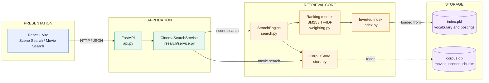
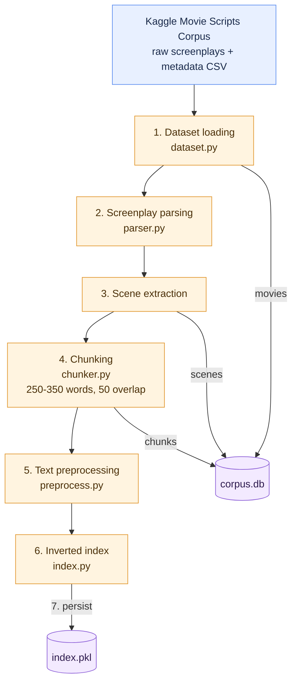
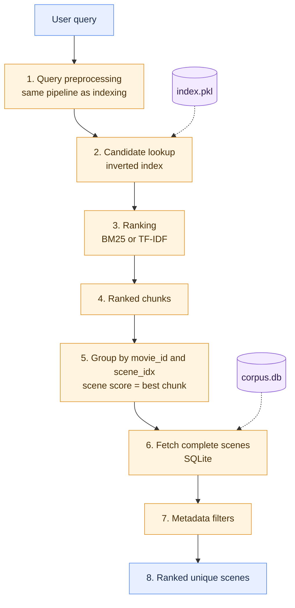
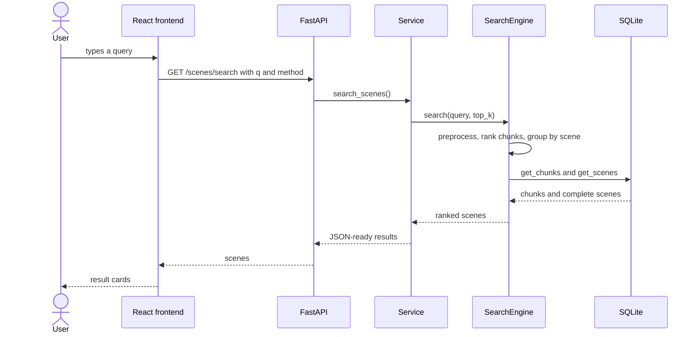
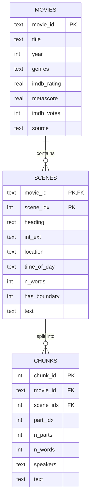
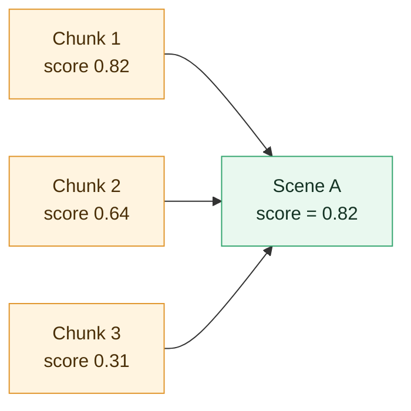
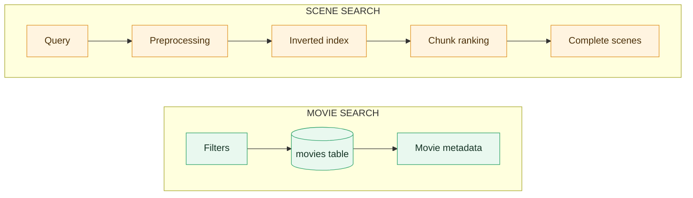

<div align="center">

# 🎬 CinemaSearch

**Describe a movie scene in your own words. Get the scene back.**

An Information Retrieval system for movie screenplays, built on a custom inverted index.


</div>

**CinemaSearch** lets users describe a scene using natural language and retrieves the most relevant complete scenes from a large screenplay collection. It also provides an independent movie search based on metadata.

The project is built on the Kaggle Movie Scripts Corpus and uses a custom inverted index instead of an external search library.

---

## Quick Start

```cmd
pip install -r requirements.txt
pip install fastapi uvicorn

python -m irsearch build "C:\path\to\movies_script" --out out_full --min-words 250 --max-words 350 --overlap 50 --speaker-mode separate --source auto

python -m uvicorn api:app --port 8000
```

In a second terminal:

```cmd
cd frontend
npm install
npm run dev
```

Open `http://localhost:5173`. The build step is run once; it is described in [section 13](#13-building-the-corpus).

---

## Table of Contents

1. [Project Overview](#1-project-overview)
2. [Main Features](#2-main-features)
3. [Technologies](#3-technologies)
4. [Complete Architecture](#4-complete-architecture)
5. [Offline Indexing Workflow](#5-offline-indexing-workflow)
6. [Online Search Workflow](#6-online-search-workflow)
7. [Scenes vs Chunks](#7-scenes-vs-chunks)
8. [Ranking Models](#8-ranking-models)
9. [Movie Metadata Search](#9-movie-metadata-search)
10. [Dataset](#10-dataset)
11. [Project Structure](#11-project-structure)
12. [Installation and Setup](#12-installation-and-setup)
13. [Building the Corpus](#13-building-the-corpus)
14. [Running the Application](#14-running-the-application)
15. [API Endpoints](#15-api-endpoints)
16. [Testing and Evaluation](#16-testing-and-evaluation)
17. [Experiments and Design Decisions](#17-experiments-and-design-decisions)
18. [Full Corpus Statistics](#18-full-corpus-statistics)
19. [Limitations and Future Improvements](#19-limitations-and-future-improvements)

---

## 1. Project Overview

CinemaSearch provides two independent search functionalities.

### 1.1 Scene Search

This is the core functionality of the project.

The user enters a description or keywords related to a scene. The system searches the screenplay collection, identifies relevant passages, ranks their parent scenes, and returns the complete scenes.

For example:

```text
love friendship and relationships
```

The objective is to retrieve the exact scene, or at least the closest relevant scene available in the corpus.

Results include:

- Movie title and release year
- Genres, IMDb rating, metascore and votes (when available)
- Scene heading
- Complete scene text
- Relevance score
- Number of matching chunks

### 1.2 Movie Search

Users can independently browse and search movies using metadata:

- Movie title
- Release year
- IMDb rating range

Movie search does not depend on screenplay text or the inverted index.

---

## 2. Main Features

- Natural-language screenplay scene search.
- Retrieval of complete scenes instead of isolated text passages.
- Custom inverted index.
- BM25 ranking (default) and TF-IDF with cosine similarity, selectable per request.
- Movie metadata search.
- Scene search filters: movie title, year and IMDb rating range.
- SQLite-based structured storage.
- Scene-level retrieval evaluation.
- FastAPI backend.
- React + Vite frontend with a liquid-glass design.

---

## 3. Technologies

| Technology | Purpose |
|---|---|
| Python 3.10+ | Retrieval engine and data processing |
| SQLite | Movie, scene and chunk storage |
| Pickle | Saving the custom inverted index |
| BM25 | Information retrieval ranking (default) |
| TF-IDF | Alternative ranking model |
| FastAPI | Backend API |
| Uvicorn | API server |
| React | Frontend interface |
| Vite | Frontend development server |
| pytest | Automated testing |

The retrieval engine is implemented in Python. The React frontend communicates with it through the FastAPI backend.

---

## 4. Complete Architecture

CinemaSearch is divided into two major workflows:

1. **Offline Indexing Phase:** processes the screenplay collection and creates the searchable database and index.
2. **Online Search Phase:** processes user queries, retrieves matching chunks, ranks them and returns complete scenes.

### 4.1 System overview

The application is organized in four layers. The frontend never touches the data directly; every request goes through the API and the service layer.



### 4.2 Offline indexing pipeline

Run once with `python -m irsearch build`. It produces the two storage artifacts.



### 4.3 Online search pipeline

Runs for every scene-search request.



### 4.4 One request, end to end



### 4.5 Data model



Two storage systems are used:

| Storage | Information | Purpose |
|---|---|---|
| `corpus.db` | Movies, complete scenes, chunks and metadata | Stores readable content and structured information |
| `index.pkl` | Vocabulary, postings and term/document statistics | Supports efficient retrieval and ranking |

The inverted index references chunks using their IDs:

```text
doc_id == chunk_id
```

SQLite maintains the relationship between each chunk and its original scene.

---

## 5. Offline Indexing Workflow

The offline phase prepares the screenplay collection before users start searching.

### Phase 1 — Dataset Loading

**Module:** `irsearch/dataset.py`

The dataset loader discovers screenplay files and metadata files, reads their contents and associates screenplay files with movie records.

Its responsibilities include:

- Discovering raw screenplay files.
- Reading movie metadata.
- Extracting movie titles and release years.
- Matching screenplay files with metadata, primarily through IMDb identifiers.
- Handling incomplete metadata.

**Why this phase is necessary:**

The original dataset contains multiple directories and file formats. The loader provides a consistent structure for the rest of the system.

### Phase 2 — Screenplay Parsing

**Module:** `irsearch/parser.py`

A screenplay is not ordinary text. It contains different structural elements:

- Scene headings.
- Character headings.
- Dialogue.
- Parentheticals.
- Action descriptions.
- Transitions.

Example:

```text
INT. HEADQUARTERS - DAY

JOY
Yup, Goofball is the best!

Joy looks at FRIENDSHIP ISLAND.
```

The parser identifies scene boundaries and extracts structured scene information.

A scene contains information such as:

- Scene index.
- Heading.
- Interior or exterior indicator.
- Location.
- Time of day.
- Word count.
- Original scene text.

**Why parsing is necessary:**

The project must retrieve meaningful screenplay scenes rather than arbitrary text passages. Parsing establishes the scene structure needed for later chunking and complete-scene retrieval.

### Phase 3 — Scene Extraction

The parser produces an ordered collection of scenes for each movie.

```text
Movie
  |
  +-- Scene 0
  +-- Scene 1
  +-- Scene 2
  +-- ...
```

Each scene is identified using:

```python
(movie_id, scene_idx)
```

This pair allows the retrieval engine to identify the original scene after searching its chunks.

Some screenplays do not have reliably detected scene boundaries. The system also tracks pseudo-scenes created when explicit boundaries cannot be identified.

**Why this phase is necessary:**

Scene identity is the connection between the internal retrieval system and the complete scene returned to the user.

### Phase 4 — Chunking

**Module:** `irsearch/chunker.py`

After scene extraction, scenes are divided into smaller searchable units called chunks.

The full-corpus build used:

| Parameter | Value |
|---|---:|
| Minimum target size | 250 words |
| Maximum target size | 350 words |
| Overlap | 50 words |
| Speaker mode | `separate` |

The chunking logic follows these principles:

- Short scenes can remain a single chunk.
- Long scenes are divided into smaller chunks.
- Consecutive chunks overlap.
- Cuts are aligned with line boundaries where possible.
- Chunk sizes are kept close to the configured range.

Example:

```text
Scene A
   |
   +-- Chunk 1: words 1–300
   |
   +-- Chunk 2: words 251–550
   |
   +-- Chunk 3: words 501–750
```

The example illustrates the overlap principle. Actual chunk sizes depend on the scene length and cut positions.

**Why chunks are used:**

1. Complete scenes can be very long.
2. A query may match only one passage inside a scene.
3. Smaller chunks make retrieval more focused.
4. Overlap reduces the risk of losing relevant passages at chunk boundaries.
5. Chunks can be efficiently indexed and ranked.

**Important:** Chunks are internal retrieval units. The final user receives the complete parent scene.

### Phase 5 — Text Preprocessing

**Module:** `irsearch/preprocess.py`

Preprocessing prepares screenplay text for indexing.

The implemented operations include:

- Lowercasing.
- Unicode normalization.
- Accent handling.
- Tokenization.
- Stopword removal.
- Stemming when enabled.
- Handling of relevant acronyms and token forms.

The same preprocessing logic is applied to user queries.

Example:

```text
Original:
Love, Friendship and Relationships

Processed:
love friendship relationship
```

The exact output depends on the configured stopwords and stemming options.

**Why preprocessing is necessary:**

It reduces irrelevant differences between words and ensures that screenplay text and user queries are represented consistently.

### Phase 6 — Inverted Index Construction

**Module:** `irsearch/index.py`

The processed chunks are used to build a custom inverted index.

An inverted index maps each term to the documents in which it occurs.

Example:

```text
Term: friendship
    |
    +-- Chunk 12
    +-- Chunk 48
    +-- Chunk 91

Term: love
    |
    +-- Chunk 12
    +-- Chunk 25
    +-- Chunk 91
```

The index stores important information:

| Concept | Meaning |
|---|---|
| TF | Number of occurrences of a term in a document |
| DF | Number of documents containing a term |
| CF | Total occurrences of a term in the collection |
| Postings | Documents associated with a term and their statistics |
| Document length | Number of indexed terms in a chunk |

Each chunk is assigned a document ID:

```text
doc_id == chunk_id
```

**Why an inverted index is necessary:**

Without an inverted index, every search would require scanning the screenplay collection. The inverted index allows the system to find candidate chunks through their terms.

### Phase 7 — Persistence

**Modules:** `irsearch/store.py`, `irsearch/index.py`, `irsearch/pipeline.py`

The system saves:

- Movie records.
- Complete scenes.
- Chunks.
- Inverted index data.

The readable data is stored in SQLite, while the inverted index is saved as a Pickle file.

**Why persistence is necessary:**

Building the index is computationally expensive. Saving it allows the application to load the prepared corpus without rebuilding everything every time it starts.

---

## 6. Online Search Workflow

The online phase begins when the user submits a query.

### Phase 1 — User Query

Example:

```text
love friendship and relationships
```

The query is sent to the FastAPI backend, passed to the service layer and then to the search engine.

### Phase 2 — Query Preprocessing

The query is processed using the same preprocessing configuration used during indexing.

```text
Original Query
      |
      v
Normalization
      |
      v
Tokenization
      |
      v
Stopword Removal
      |
      v
Stemming
      |
      v
Processed Query Terms
```

**Why:**

Query terms must have the same representation as indexed screenplay terms.

### Phase 3 — Candidate Retrieval

The search engine looks up query terms in the inverted index.

Each term provides postings containing the chunk IDs in which it appears.

The engine gathers the candidate chunks and their statistics.

**Why:**

This avoids scanning every screenplay and narrows the ranking process to candidate documents.

### Phase 4 — Ranking

**Module:** `irsearch/weighting.py`

Candidate chunks are scored using one of two ranking models:

- BM25 (default).
- TF-IDF with cosine similarity.

The selected method determines the order of matching chunks.

### Phase 5 — Chunk Retrieval

The ranked chunk IDs are used to retrieve their original records from SQLite.

Each chunk contains information such as:

- `chunk_id`
- `movie_id`
- `scene_idx`
- `part_idx`
- `n_parts`
- `n_words`
- Speaker information.
- Original readable text.

This makes it possible to identify the parent scene of each matching chunk.

### Phase 6 — Grouping Chunks by Scene

**Module:** `irsearch/search.py`

Multiple matching chunks may belong to the same scene.

Returning every chunk independently would produce duplicate scene results.

The system groups chunks using:

```python
(movie_id, scene_idx)
```

The current scene-scoring strategy uses the highest-scoring matching chunk.



**Why use the maximum score?**

Adding all chunk scores could unfairly favor long scenes because they contain more chunks.

Using the highest matching chunk score allows a scene to be ranked according to its strongest matching passage.

The matching chunk information is also retained for each result.

**Getting enough unique scenes:** several top chunks often belong to the same scene, so the engine first retrieves 20 × `top_k` chunks. If these produce fewer than `top_k` unique scenes, it retrieves more chunks, multiplying the limit by 4 each time up to a cap of 8,000 chunks.

### Phase 7 — Retrieve Complete Scenes

**Module:** `irsearch/store.py`

Once matching scenes have been identified, the search engine retrieves their complete original text from SQLite.

The storage layer provides:

- `get_scene()` — retrieves one complete scene.
- `get_scenes()` — retrieves multiple complete scenes.

The returned scene includes its movie metadata and complete screenplay text.

**Why this is important:**

Chunking improves retrieval precision, but the user should not have to reconstruct the original scene from separate chunks.

### Phase 8 — Metadata Filtering

Scene search can apply these metadata filters:

- Movie title.
- Release year.
- IMDb rating range.

The search engine also contains a genre filter, but it is not exposed by the API or the interface.

Movie search uses the SQLite movie table directly.

### Phase 9 — Return Ranked Scenes

The search engine returns unique, ranked scene results.

FastAPI sends them to the frontend, which displays the movie information, scene heading, score and complete screenplay text.

---

## 7. Scenes vs Chunks

Understanding the difference between scenes and chunks is essential to understanding CinemaSearch.

| Element | Purpose |
|---|---|
| Movie | Contains screenplay and movie metadata |
| Scene | Meaningful screenplay unit |
| Chunk | Smaller searchable passage inside a scene |
| Term | Processed word |
| Posting | Connects a term to a chunk and its statistics |

### Why not index only complete scenes?

A long scene can contain many unrelated passages. A query might match only a small section, and indexing the entire scene as one document can make retrieval less focused.

### Why not return only chunks?

A chunk may start or end in the middle of a scene. Returning it alone would not satisfy the requirement to retrieve the complete scene.

### The chosen solution


This combines focused retrieval with meaningful user-facing results.

---

## 8. Ranking Models

CinemaSearch implements two ranking models to compare their retrieval behavior.

### 8.1 TF-IDF with Cosine Similarity

**Class:** `WeightingModel`

TF-IDF assigns importance to terms based on their frequency in a document and their rarity across the collection.

The IDF formula used is:

$$
IDF(t)=\log\left(\frac{N+1}{DF(t)+1}\right)+1
$$

Where:

- $N$ is the number of indexed chunks.
- $DF(t)$ is the number of chunks containing term $t$.

The system creates weighted query and document vectors and compares them using cosine similarity:

$$
\operatorname{cosine}(q,d)=\frac{q\cdot d}{\lVert q\rVert\,\lVert d\rVert}
$$

A higher cosine score indicates a closer match in the weighted term space.

### 8.2 BM25

**Class:** `BM25Model`

BM25 ranks chunks using term frequency, inverse document frequency and document-length normalization.

The implemented scoring form is:

$$
BM25(q,d)=\sum_{t\in q} qtf(t)\cdot IDF(t)\cdot\frac{f(t,d)\,(k_1+1)}{f(t,d)+k_1\left(1-b+b\,\frac{|d|}{avgdl}\right)}
$$

Where:

- $f(t,d)$ is the frequency of term $t$ in chunk $d$.
- $qtf(t)$ is the frequency of term $t$ in the query, so repeated query terms count proportionally.
- $|d|$ is the chunk length.
- $avgdl$ is the average chunk length.
- $k_1$ and $b$ are BM25 parameters (defaults: $k_1=1.5$, $b=0.75$).

The implemented IDF formula is:

$$
IDF(t)=\log\left(1+\frac{N-DF(t)+0.5}{DF(t)+0.5}\right)
$$

### 8.3 Why implement both?

Both methods are lexical retrieval models, but they calculate relevance differently.

Implementing both makes it possible to compare their results using the same queries and relevance judgments.

BM25 is the default ranking method. TF-IDF can be selected per request.

**Important:** Their raw score values are on different scales. Their numeric scores should not be directly compared. Evaluation metrics are more appropriate for comparing retrieval quality.

---

## 9. Movie Metadata Search

**Method:** `search_movies()` in `irsearch/store.py`

Movie search operates directly on the SQLite `movies` table.

It supports:

- Partial case-insensitive title search.
- Exact release-year filtering.
- Minimum IMDb rating.
- Maximum IMDb rating.
- Result limit.

It does not require screenplay preprocessing or inverted-index retrieval.



Genres, IMDb rating, metascore and votes are returned with every result when the metadata provides them. Not every movie has every field, so completeness is not guaranteed.

---

## 10. Dataset

CinemaSearch uses the Kaggle Movie Scripts Corpus.

Relevant structure:

```text
movies_script/
|
+-- movie_characters/
|
+-- movie_metadata/
|   |
|   +-- metacritic_reviews_cut_versions.csv
|   +-- movie_meta_data.csv
|   +-- screenplay_awards.csv
|
+-- screenplay_data/
    |
    +-- data/
        |
        +-- BERT_annotations/
        +-- manual_annotations/
        +-- raw_texts/
        +-- raw_text_lemmas/
        +-- rule_based_annotations/
```

The current pipeline uses raw screenplay TXT files as its source text.

The annotation resources are available in the dataset but do not replace the original screenplay text in the current indexing workflow.

The main metadata CSV includes fields such as:

- IMDb ID.
- Title.
- Alternative titles.
- Year.
- Metascore.
- IMDb user rating.
- Number of IMDb user votes.
- Awards.
- Opening weekend.
- Producers.
- Budget.
- Script department.

Not every field is necessarily available for every movie.

---

## 11. Project Structure

```text
CinemaSearch/
|
+-- irsearch/
|   |
|   +-- __init__.py
|   +-- __main__.py
|   +-- models.py
|   +-- config.py
|   +-- dataset.py
|   +-- parser.py
|   +-- chunker.py
|   +-- preprocess.py
|   +-- index.py
|   +-- store.py
|   +-- pipeline.py
|   +-- cli.py
|   +-- weighting.py
|   +-- search.py
|   +-- service.py
|   +-- evaluation.py
|
+-- tests/
|   |
|   +-- test_evaluation.py
|   +-- evaluate_retrieval.py
|   +-- relevance_judgments.json
|   +-- relevance_judgments_sample.json
|   +-- relevance_judgments_full.json
|
+-- frontend/
|   |
|   +-- src/
|   +-- public/
|   +-- package.json
|   +-- ...
|
+-- api.py
+-- requirements.txt
+-- .gitignore
+-- out_full/
|   |
|   +-- corpus.db
|   +-- index.pkl
|   +-- ...
|
+-- README.md
```

### Module responsibilities

| File | Responsibility |
|---|---|
| `models.py` | Movie, scene, element and chunk data structures |
| `config.py` | Parser, chunking, preprocessing and index configuration |
| `dataset.py` | Dataset discovery and metadata matching |
| `parser.py` | Screenplay structure and scene extraction |
| `chunker.py` | Scene splitting and overlapping chunks |
| `preprocess.py` | Normalization and tokenization |
| `index.py` | Custom inverted index |
| `store.py` | SQLite storage and retrieval |
| `pipeline.py` | Build and load orchestration |
| `cli.py` | Command-line operations |
| `weighting.py` | BM25 and TF-IDF scoring |
| `search.py` | Query processing and scene-level retrieval |
| `service.py` | Service layer: loads the corpus once and exposes movie search and scene search |
| `evaluation.py` | Retrieval evaluation metrics |
| `api.py` | FastAPI backend |
| `frontend/` | React + Vite interface |

### Frontend structure

```text
frontend/src/
|
+-- App.jsx                 tabs and layout
+-- api/client.js           HTTP calls to the backend
+-- hooks/useSearch.js      loading / error / result state
+-- utils/                  formatting and filter validation
+-- components/
    |
    +-- common/             GlassTabs, GlassPanel, Field, GenreChips, StatusMessage
    +-- scenes/             SceneSearch, SceneSearchForm, SceneResultList, SceneCard
    +-- movies/             MovieSearch, MovieSearchForm, MovieList, MovieCard
```

---

## 12. Installation and Setup

### Requirements

- Python 3.10 or later.
- Node.js 18 or later.
- npm.
- Kaggle Movie Scripts Corpus.

### Python setup

From the project root:

```cmd
cd C:\Users\User\Desktop\CinemaSearch
```

Install project dependencies:

```cmd
pip install -r requirements.txt
```

Install the API server:

```cmd
pip install fastapi uvicorn
```

### Frontend setup

```cmd
cd frontend
npm install
```

---

## 13. Building the Corpus

Download and extract the Kaggle Movie Scripts Corpus.

Run the build command from the project root.

### Full corpus build command used

```cmd
python -m irsearch build "C:\Users\User\Downloads\movies_script" --out out_full --min-words 250 --max-words 350 --overlap 50 --speaker-mode separate --source auto
```

### Command options

| Option | Meaning |
|---|---|
| Dataset path | Root directory of the extracted dataset |
| `--out out_full` | Output directory |
| `--min-words 250` | Minimum target chunk size |
| `--max-words 350` | Maximum target chunk size |
| `--overlap 50` | Overlap between chunks |
| `--speaker-mode separate` | Keep speaker information separate from indexed text |
| `--source auto` | Automatically select the supported screenplay source |

To inspect CLI options:

```cmd
python -m irsearch --help
```

```cmd
python -m irsearch build --help
```

The dataset and generated `out_full/` directory are not included in the repository.

**Important:** The build is an offline operation and can take time. Once the database and index have been generated, normal searches should load the saved files instead of rebuilding the corpus.

---

## 14. Running the Application

### 14.1 Start the backend

From the project root:

```cmd
python -m uvicorn api:app --port 8000
```

Backend address:

```text
http://127.0.0.1:8000
```

Interactive API documentation:

```text
http://127.0.0.1:8000/docs
```

### 14.2 Start the frontend

Open a second terminal:

```cmd
cd C:\Users\User\Desktop\CinemaSearch\frontend
npm install
npm run dev
```

Open:

```text
http://localhost:5173
```

### 14.3 Frontend API configuration

To use another API address:

1. Copy `frontend/.env.example` to `frontend/.env`.
2. Edit `VITE_API_URL`.
3. Restart the frontend development server.

Example:

```env
VITE_API_URL=http://127.0.0.1:8000
```

---

## 15. API Endpoints

| Method | Endpoint | Description |
|---|---|---|
| GET | `/movies` | Movie metadata search |
| GET | `/scenes/search` | Screenplay scene search |
| GET | `/scenes/{movie_id}/{scene_idx}` | Retrieve one complete scene |

### Movie search

```text
GET /movies
```

Parameters:

- `title`
- `year`
- `min_rating`
- `max_rating`
- `limit`

Example:

```text
http://127.0.0.1:8000/movies?title=Inside%20Out&year=2015
```

### Scene search

```text
GET /scenes/search
```

Parameters:

- `q`: Search query.
- `top_k`: Number of results.
- `method`: `bm25` or `tfidf`.
- `title`: Optional movie-title filter.
- `year`: Optional release-year filter.
- `min_rating`: Optional minimum IMDb rating.
- `max_rating`: Optional maximum IMDb rating.

BM25 example:

```text
http://127.0.0.1:8000/scenes/search?q=love%20friendship%20and%20relationships&top_k=5&method=bm25
```

TF-IDF example:

```text
http://127.0.0.1:8000/scenes/search?q=love%20friendship%20and%20relationships&top_k=5&method=tfidf
```

Example response (shortened):

```json
{
  "query": "love",
  "method": "bm25",
  "count": 10,
  "results": [
    {
      "movie_id": "tt0097216",
      "scene_idx": 69,
      "heading": "INT: CONTROL BOOTH--DUSK",
      "int_ext": "INT",
      "location": ": CONTROL BOOTH",
      "time_of_day": "DUSK",
      "n_words": 181,
      "text": "INT: CONTROL BOOTH--DUSK\nCLOSE--MISTER SEÑOR LOVE DADDY\n...",
      "title": "Do the Right Thing",
      "year": 1989,
      "genres": ["Comedy", "Drama"],
      "imdb_rating": 8,
      "metascore": 93,
      "imdb_votes": 88081,
      "score": 5.97,
      "ranking_method": "bm25",
      "matched_chunk_count": 1,
      "matched_chunk_ids": [91894]
    }
  ]
}
```

### Retrieve a complete scene

```text
GET /scenes/{movie_id}/{scene_idx}
```

Use the interactive documentation at `/docs` to inspect the actual request parameters and response schemas.

**Performance note:** The first TF-IDF request is slower because document vectors are built on demand. BM25 is the default method.

---

## 16. Testing and Evaluation

Testing was performed at different levels throughout development.

The main objective is not only to check whether the code executes, but also whether the system retrieves relevant screenplay scenes.

### 16.1 Evaluation metric tests

File:

```text
tests/test_evaluation.py
```

The evaluation module implements:

| Metric | Purpose |
|---|---|
| Precision@K | Fraction of the top K results that are relevant |
| Recall@K | Fraction of known relevant results retrieved in the top K |
| F1@K | Harmonic mean of precision and recall |
| Average Precision | Ranking quality for one query |
| MAP | Mean Average Precision across queries |

Run:

```cmd
python -m pytest tests/test_evaluation.py -v
```

The recorded run had:

```text
13 passed
```

### 16.2 Real-data indexing tests

The indexing implementation was tested against a smaller sample of real screenplay data.

The real-data checks passed, and an index was successfully saved.

The generated test index was:

```text
out/index_real_test.pkl
```

These checks verified that the custom index could be constructed and saved using real screenplay content.

### 16.3 Scene-level retrieval evaluation

File:

```text
tests/evaluate_retrieval.py
```

Run:

```cmd
python -m tests.evaluate_retrieval
```

Useful options:

```cmd
python -m tests.evaluate_retrieval --top-k 10
```

```cmd
python -m tests.evaluate_retrieval --methods bm25 tfidf
```

```cmd
python -m tests.evaluate_retrieval --show-candidates
```

```cmd
python -m tests.evaluate_retrieval --rewrite-qrels
```

| Option | Purpose |
|---|---|
| `--top-k 10` | Evaluate the top 10 scenes |
| `--methods bm25 tfidf` | Compare both ranking models |
| `--show-candidates` | Display pooled candidates from both models for queries that still need judgments |
| `--rewrite-qrels` | Convert chunk-ID judgments to scene IDs and save them back to the judgments file |

For each query, the report shows AP@k and the number of retrieved scenes that have not been judged, so incomplete judgments are visible.

### 16.4 Relevance judgments

The full relevance-judgment file is:

```text
tests/relevance_judgments_full.json
```

Judgments identify scenes using:

```text
movie_id:scene_idx
```

The evaluation is performed at scene level because the application returns complete scenes, not chunks.

Judgments are created by inspecting retrieved candidates and deciding which scenes are relevant to each query.

**Pooling.** Candidates for judging are pooled from both ranking models (`--show-candidates`). Judging only the results of one model would bias the comparison in its favor, because relevant scenes found only by the other model would be counted as misses.

A small number of judgments is useful for debugging, but broader query coverage is required to make reliable claims about retrieval quality.

### 16.5 Dataset inspection

Inspect the dataset:

```cmd
python -m irsearch inspect "C:\Users\User\Downloads\movies_script"
```

The report includes the fill rate of each metadata field (year, rating, metascore, votes, genres).

Inspect command options:

```cmd
python -m irsearch --help
```

```cmd
python -m irsearch build --help
```

### 16.6 Direct scene-search test

The following command was used to verify scene-level retrieval against the full corpus:

```cmd
python -c "from irsearch.pipeline import load; from irsearch.search import SearchEngine; index, store, prep, cfg = load('out_full'); engine = SearchEngine(index, store, prep, ranking_method='tfidf'); results = engine.search('love friendship and relationships', top_k=5); [(print('\nRANK:',i+1), print('MOVIE:',r['title'],r['year']), print('SCENE:',r['scene_idx'],r['heading']), print('SCORE:',round(r['score'],4)), print('MATCHING CHUNKS:',r['matched_chunk_count']), print('COMPLETE SCENE:\n',r['text'][:1200])) for i,r in enumerate(results)]; store.close()"
```

This test verified:

- Loading the saved index and SQLite database.
- Query preprocessing.
- TF-IDF ranking.
- Grouping matching chunks into unique scenes.
- Retrieving complete scenes.
- Returning movie metadata and scene scores.

The command prints only the first 1,200 characters of each scene for readability. The actual `r['text']` contains the complete scene.

### 16.7 Movie search and complete-scene retrieval test

The storage methods were tested using:

```cmd
python -c "from irsearch.pipeline import load; index, store, prep, cfg = load('out_full'); movies = store.search_movies(title='Inside Out'); print('MOVIE SEARCH:'); [print(m['title'], m['year']) for m in movies]; movie = movies[0]; scene = store.get_scene(movie['movie_id'], 27); print('\nCOMPLETE SCENE:'); print(scene['title'], scene['year'], scene['heading']); print(scene['text'][:1000]); store.close()"
```

This confirmed that:

- Movie metadata can be searched independently.
- A movie can be selected from the search results.
- A complete scene can be retrieved using its movie ID and scene index.

### 16.8 End-to-end test

The API and the interface were checked together:

- Scene search with BM25 and with TF-IDF.
- Scene search with a title or year filter.
- Movie search with a rating filter.

The interactive documentation at `/docs` can be used to repeat the API checks without the frontend.

### 16.9 Test summary

| Test | What it verifies |
|---|---|
| Evaluation unit tests | Correctness of metric calculations |
| Real-data indexing checks | Index construction and persistence |
| Scene-search smoke test | Query-to-complete-scene retrieval |
| Movie-search test | Independent metadata search |
| Scene retrieval test | Complete scene retrieval from SQLite |
| End-to-end test | API and interface working together |
| Retrieval evaluation | Relevance and ranking quality |

A successful smoke test proves that the workflow executes. Retrieval evaluation is needed to measure whether the results are actually relevant.

---

## 17. Experiments and Design Decisions

### 17.1 Using raw screenplay text

The dataset contains raw screenplays and annotation resources.

The current pipeline uses raw TXT screenplays.

**Reason:** The original screenplay text is required to preserve readable, complete scenes. Annotation resources can support future improvements but do not replace the raw screenplay source in the current pipeline.

### 17.2 Parsing before chunking

Scenes are extracted before they are divided into chunks.

**Reason:** If an entire screenplay were chunked without considering scene boundaries, a chunk could contain the end of one scene and the beginning of another. That would complicate complete-scene retrieval.

### 17.3 Chunk size and overlap

The full-corpus build used 250–350-word target chunks with 50-word overlap.

**Reason:** Chunks must be small enough for focused retrieval while retaining sufficient context. Overlap reduces the risk of losing relevant passages at boundaries.

### 17.4 Speaker handling

The full build used:

```text
--speaker-mode separate
```

The configuration also supports:

```text
separate
unit_once
keep
```

**Reason:** Speaker labels are structural screenplay information. Their treatment can influence the terms included in the index.

### 17.5 Custom inverted index

The project implements its own inverted index rather than relying on an external search library.

**Reason:** This makes it possible to implement and understand the core Information Retrieval concepts directly:

- Vocabulary.
- Term frequency.
- Document frequency.
- Collection frequency.
- Postings.
- Document lengths.
- Ranking models.

### 17.6 BM25 and TF-IDF comparison

Both ranking methods were implemented and tested using screenplay data.

One comparison used:

```text
love friendship and relationships
```

The two methods returned different rankings.

TF-IDF placed several *Inside Out* scenes near the top, while BM25 produced a different ordering.

**Reason for retaining both:** One query is not enough to establish which ranking model performs better. The evaluation dataset is used to compare their performance over multiple manually judged queries.

BM25 is the default method, and TF-IDF remains selectable.

### 17.7 Maximum chunk score for scene ranking

When multiple chunks from one scene match, the current scene score is the highest matching chunk score.

**Reason:** Summing chunk scores could give longer scenes an advantage simply because they contain more chunks.

The maximum-score strategy is an initial design decision that can be evaluated and improved later.

### 17.8 Scene-level evaluation

Relevance judgments use:

```text
movie_id:scene_idx
```

rather than chunk IDs.

**Reason:** The user receives complete scenes, so evaluation must measure the quality of complete scene retrieval.

### 17.9 Separate movie and scene search

Movie search uses SQLite metadata. Scene search uses the inverted index and ranking models.

**Reason:** They represent different retrieval tasks and require different search strategies.

### 17.10 Service layer and lazy ranking engines

The API calls a `CinemaSearchService` instead of the search engine directly. The service loads the corpus once and creates each ranking engine only when it is first requested.

**Reason:** TF-IDF builds document vectors for every chunk, which is slow and memory-heavy. BM25 does not need them, so it starts quickly and is the default.

### 17.11 Liquid-glass interface

The liquid-glass library renders each element with its own WebGL context and takes a single snapshot of the page. It is used for the two header tabs only. Cards, forms and status messages use a CSS glass style.

**Reason:** One WebGL context per result card would be slow and would leak contexts.

---

## 18. Full Corpus Statistics

The successful full-corpus build produced the following results:

| Metric | Result |
|---|---:|
| Movies processed | 2,857 |
| Movies skipped | 0 |
| Movies without metadata | 4 |
| Scenes | 349,068 |
| Pseudo-scenes without detected boundaries | 232 |
| Chunks | 425,423 |
| Processed tokens | 39,002,944 |
| Vocabulary size | 313,201 |
| Total postings | 28,788,796 |
| Average indexed chunk length | 91.68 terms |
| Build duration | Approximately 1,015.5 seconds |

The distinction between documents, scenes and movies is important:

- 2,857 movies.
- 349,068 scenes.
- 425,423 indexed chunks.

The indexed documents are chunks, not scenes or movies.

---

## 19. Limitations and Future Improvements

### Current limitations

**1. Lexical retrieval**

BM25 and TF-IDF rely primarily on term overlap. A scene described using completely different words may not rank highly, even if its meaning is similar.

**2. Screenplay parsing**

Screenplay formatting varies. Scene boundaries and headings may not be detected perfectly in every file.

**3. Metadata completeness**

Some movies have missing metadata, and not all metadata fields are populated consistently. This includes genres: they are shown when available, but their coverage across the corpus has not been verified.

**4. Filters**

Scene search filters by title, year and rating. Genre, metascore and vote filters are not exposed by the API.

**5. Scene aggregation**

The current maximum-chunk-score strategy is an initial approach. Other aggregation methods can be compared using evaluation results.

**6. Evaluation coverage**

Manual relevance judgments cover only the queries and scenes included in the evaluation files. A larger and more representative set is needed for stronger conclusions.

**7. Deployment**

The API has no authentication or rate limiting, and CORS is open to all origins. It is intended for local use and should not be exposed to the internet as it is.

### Future improvements

- Integrate semantic search using text embeddings.
- Combine lexical retrieval with semantic retrieval.
- Improve screenplay parsing using the available annotation resources.
- Compare different scene-scoring strategies.
- Expand the relevance-judgment dataset.
- Highlight the matching passage inside each complete scene.
- Add pagination and additional metadata filters, including genre.
- Measure retrieval latency and memory consumption on the full corpus.

These are possible future extensions, not features that should be assumed to be implemented already.

---

## Credits

- **Dataset:** Kaggle Movie Scripts Corpus.
- **Interface effects:** [liquid-glass-js](https://github.com/dashersw/liquid-glass-js) by dashersw (MIT license).
